# StockMate · Inventory Management (Arabic / English)

**StockMate | ستوك ميت** is a bilingual inventory management prototype: products, stock in and out, low-stock alerts and inventory value in SAR. Works fully in Arabic (RTL) and English (LTR).

Built with **React, TypeScript and Vite**. Data is stored in the browser (`localStorage`); there is no backend, account or API key.

<div dir="rtl">

نظام لإدارة المخزون بالعربي والإنجليزي: المنتجات، حركات الإدخال والإخراج، تنبيهات نقص المخزون، وقيمة المخزون بالريال. البيانات تُحفظ في المتصفح فقط.

</div>

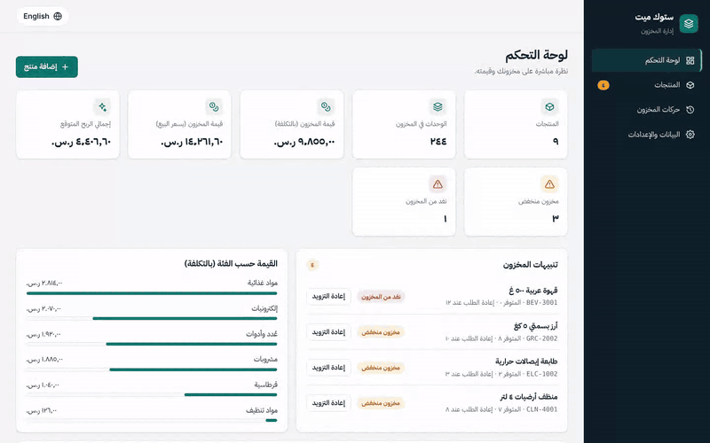

## Screenshots

| Arabic (RTL) | English (LTR) |
| --- | --- |
| 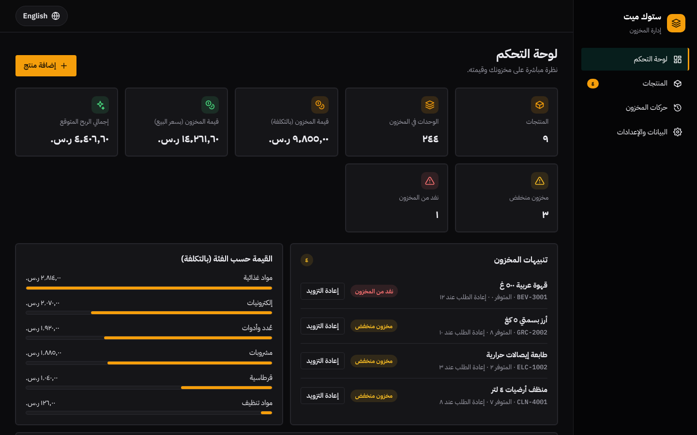 | 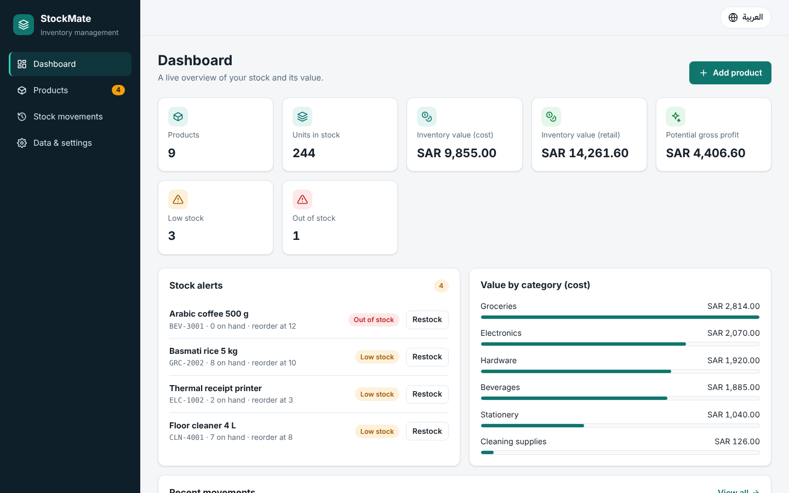 |
| 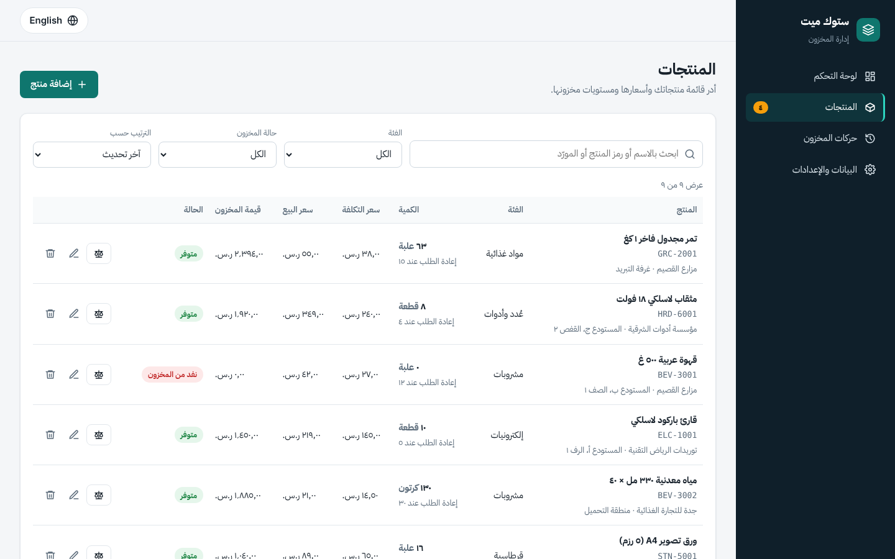 | 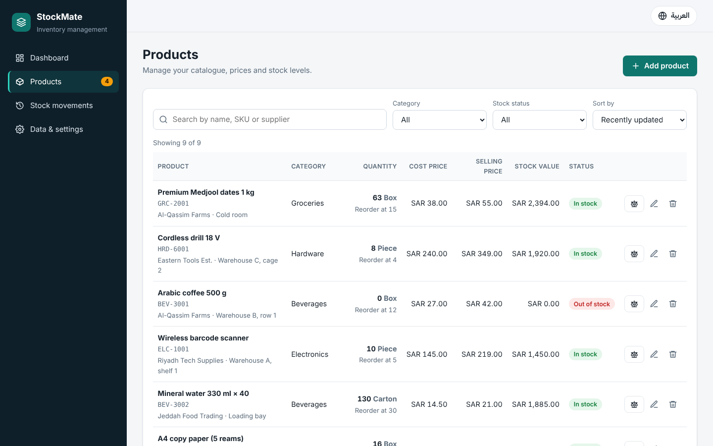 |

**Stock movements log (Arabic)**

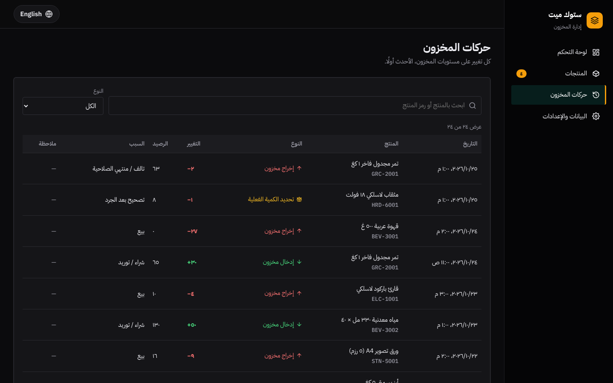

**Mobile**

| Arabic | New product (Arabic) | English | Menu and scrolling (Arabic) |
| --- | --- | --- | --- |
| 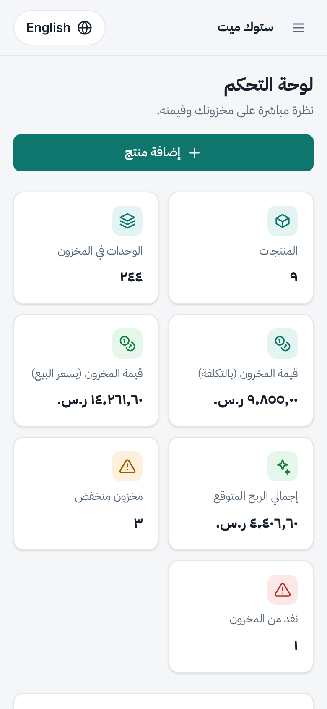 | 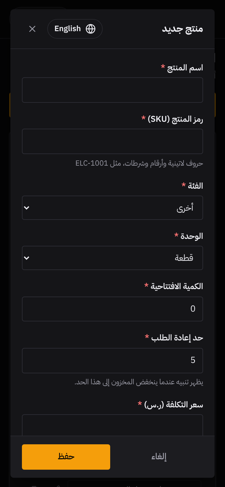 | 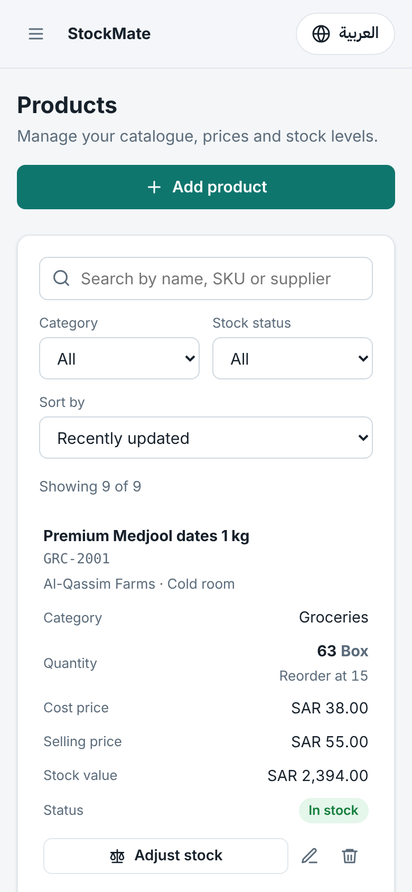 | 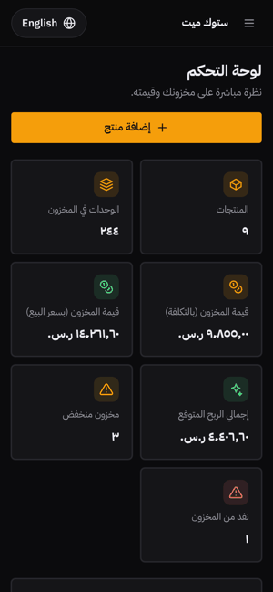 |

**Recording a stock movement:** search, stock in, then the movements log

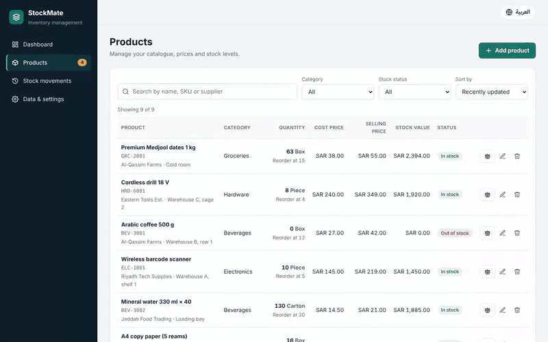

## What's inside

| Area | What it does |
| --- | --- |
| Dashboard | Product count, units in stock, value at cost and retail, potential profit, low / out-of-stock counts, alerts with one-click restock, value by category, recent movements |
| Products | Add, edit and delete with validation (unique SKU, whole quantities, prices up to 2 decimals, Arabic-Indic digits accepted) |
| Search & filters | By name, SKU, supplier or location; filter by category or stock status; sort. Arabic search ignores diacritics and letter variants |
| Stock movements | Stock in, stock out, or set the exact count after a physical count. Stock never goes negative, and every change is logged with the running balance |
| Data & settings | Export / import a JSON backup (checked before it replaces anything), load sample data, clear all data |

**Bilingual details:** typed `en` / `ar` dictionaries (a missing Arabic key fails the build), `<html lang dir>` switches with the language, the choice is saved, and Arabic is the default. Arabic uses Arabic-Indic digits (`٩٬٨٥٥٫٠٠ ر.س.`), English uses `SAR 9,855.00`. The sidebar and drawer move to the right in Arabic, and switching language inside an open form keeps everything typed.

## Run it

Requires Node.js 20+.

```bash
npm install
npm run dev        # http://localhost:5173
```

On first run the app is empty: click **Load sample data** on the dashboard to fill it.

| Command | What it does |
| --- | --- |
| `npm run build` | Type-check and build to `dist/` |
| `npm run lint` | ESLint |
| `npm test` | Unit tests (Vitest): calculations, validation, movements, search, storage |
| `npm run test:e2e` | Playwright tests on desktop, tablet and mobile (run `npx playwright install chromium` once) |

## Project structure

```
src/
  i18n/        en.ts, ar.ts, language context, formatting
  domain/      pure inventory logic: status, value, validation, movements, storage
  state/       InventoryContext (reducer + persistence)
  components/  Layout, LanguageSwitcher, Modal, Toast, forms, tables
  pages/       Dashboard, Products, Movements, Settings
tests/e2e/     Playwright tests
```

## Deploy

Static build with hash routing (`#/products`) and relative paths, so it runs on any static host.

- **Vercel / Netlify / Cloudflare Pages:** import the repository; build command `npm run build`, output `dist`.
- **GitHub Pages (optional):** in the repository open **Settings → Pages → Source → GitHub Actions**, then run **Actions → Deploy to GitHub Pages → Run workflow**.
- **CI:** `.github/workflows/ci.yml` lints, tests and builds on every push.

**Limits by design:** data is per browser and device, one currency (SAR), no VAT, purchase orders or multiple warehouses.

## License

MIT.
